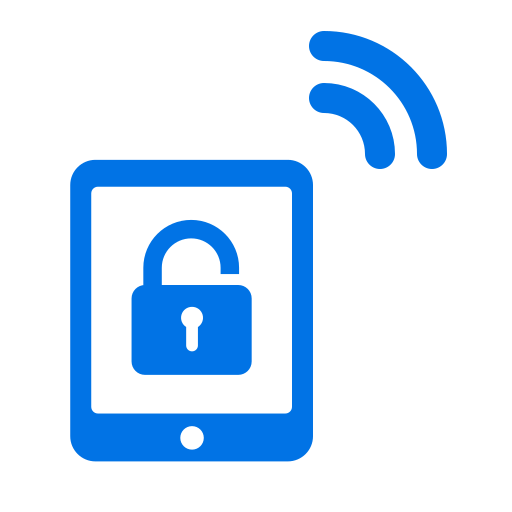

# ioBroker.freekiosk

**Tests:** 

## FreeKiosk adapter for ioBroker

[FreeKiosk](https://freekiosk.app) ([RushB-fr/freekiosk](https://github.com/RushB-fr/freekiosk)) is an open-source kiosk app for Android tablets, an alternative to Fully Kiosk Browser. This adapter reads the status of your FreeKiosk tablets into ioBroker states and lets scripts, Blockly and vis control them: screen, brightness, volume, URL, screensaver, text-to-speech, screenshots, camera photos, motion detection, remote keys and display mode.

Each tablet talks to the adapter over either REST (the adapter polls the tablet) or MQTT (the tablet pushes to a broker built into the adapter).

## Requirements

* FreeKiosk 2.0.0 or newer (2.0.0 is the tested version)
* Node.js 22.12 or newer

## Setup over REST

1. In FreeKiosk open Settings > Advanced > REST API, enable it, and note the port (default 8080). Optionally set an API key.
1. Turn on "Allow remote control" in FreeKiosk, otherwise the tablet refuses all commands.
1. In the adapter settings add a row to the device table (see below): transport `REST`, the tablet's host and port. If you set an API key, enter it on the REST tab.
1. The REST tab also holds the poll interval in seconds (default 30, allowed 5 to 3600; values outside that range are clamped). A new poll starts only after the previous one has finished.

## Setup over MQTT

1. In the adapter settings open the MQTT tab and set the port (default 1886), a user and a password. The base topic (default `freekiosk`) must be the same as the base topic in FreeKiosk's MQTT settings.
1. In FreeKiosk open Settings > Advanced > MQTT and enter the ioBroker host as broker, the port, the same user and password, the same base topic, and a device name.
1. Turn on "Allow remote control" in FreeKiosk.
1. Add a row to the device table (see below) with transport `MQTT`. The topic ID is FreeKiosk's device name in lowercase with spaces replaced by `_`; it is optional and may stay empty when it equals the object ID in lowercase.

Only over MQTT: motion detection, always-on motion detection, periodic screenshots and camera photos, and their intervals. Screenshots and camera photos work over both transports: over REST the adapter downloads them directly when you press the button (screenshot as PNG, camera photo as JPEG); over MQTT the tablet publishes them (JPEG) to the broker.

## Device table

One row per tablet, up to 50 rows. A row that fails validation is logged and skipped; the other tablets keep running.

* **Object ID**: ASCII letters, digits, `_` and `-`, at most 32 characters, unique regardless of case, and not `info`.
* **Transport**: `REST` or `MQTT`.
* **Host and port** (REST only): the port defaults to 8080. MQTT rows need neither.
* **Topic ID** (MQTT only): may stay empty when FreeKiosk's device name, in lowercase with spaces as `_`, equals the object ID in lowercase.

## Security

The built-in broker and FreeKiosk's REST API are not encrypted. Keep both inside your LAN, never forward their ports to the internet, and use a broker password that you use nowhere else.

## States

Each tablet is a device object named after its ID in the device table.

| Channel | Content |
|---|---|
| `info` | online flag, last update, transport, FreeKiosk version, model, manufacturer, Android version, IP, device owner and kiosk mode |
| `battery` | level, charging, temperature |
| `screen` | screen on/off, brightness, screensaver (active, and a switch that shows the last acknowledged command because FreeKiosk does not report the setting), auto-brightness (read only) |
| `webview` | current URL (writable to navigate), loading, can go back, URL rotation |
| `wifi` | SSID, signal strength (dBm and %) |
| `sensors` | light, proximity; over MQTT also motion and motion always on |
| `audio` | volume |
| `system` | memory used, free storage |
| `images` | paths of the latest screenshot and camera photos with their time; over MQTT also auto-capture switches and intervals |
| `commands` | reload, wake, reboot, clear cache, lock, restart UI, audio stop and beep, screenshot, camera photos, URL rotation start and stop, text-to-speech, toast, launch app, execute JavaScript, audio play, mode |
| `remote` | D-pad and navigation buttons, key, key combo and text input |

* Buttons: write `true`.
* `commands.audioPlay` takes a URL or JSON such as `{"url":"http://...","loop":false,"volume":50}`.
* `commands.mode` takes `{"mode":"webview","url":"http://..."}`, `{"mode":"external_app","package":"com.example.app"}` or `{"mode":"media_player"}`.
* Images are stored in the instance file storage. To show one in vis, use the path from `images.*`; the web adapter serves it as `/freekiosk.0/<id>/<file>`.
* If nothing happens when you send a command, check "Allow remote control" in FreeKiosk first. With it off, REST refuses commands (the adapter logs a warning), while MQTT commands are dropped silently by FreeKiosk.
* A command is acknowledged only after the tablet accepted it. If the tablet is offline, the command is dropped with a warning and not queued.

## Known limits

* Auto-brightness can be read but not switched; FreeKiosk 2.0.0 has no command for it.
* The objects of a removed tablet stay until you delete them by hand.
* One API key and one broker login are shared by all tablets.
* No TLS for the broker.

## Logo

The adapter icon is the FreeKiosk logo from [RushB-fr/freekiosk](https://github.com/RushB-fr/freekiosk), used under the MIT License of that project. The licence notice ships with the adapter in [THIRD-PARTY-NOTICES.md](THIRD-PARTY-NOTICES.md).

## Changelog
<!--
    Placeholder for the next version (at the beginning of the line):
    ### **WORK IN PROGRESS**
-->

### **WORK IN PROGRESS**
* (typhosj) Initial release: REST and MQTT tablets, status, commands, screenshots, camera photos, motion detection

## License
MIT License

Copyright (c) 2026 typhosj <typhosj@gmx.de>

Permission is hereby granted, free of charge, to any person obtaining a copy
of this software and associated documentation files (the "Software"), to deal
in the Software without restriction, including without limitation the rights
to use, copy, modify, merge, publish, distribute, sublicense, and/or sell
copies of the Software, and to permit persons to whom the Software is
furnished to do so, subject to the following conditions:

The above copyright notice and this permission notice shall be included in all
copies or substantial portions of the Software.

THE SOFTWARE IS PROVIDED "AS IS", WITHOUT WARRANTY OF ANY KIND, EXPRESS OR
IMPLIED, INCLUDING BUT NOT LIMITED TO THE WARRANTIES OF MERCHANTABILITY,
FITNESS FOR A PARTICULAR PURPOSE AND NONINFRINGEMENT. IN NO EVENT SHALL THE
AUTHORS OR COPYRIGHT HOLDERS BE LIABLE FOR ANY CLAIM, DAMAGES OR OTHER
LIABILITY, WHETHER IN AN ACTION OF CONTRACT, TORT OR OTHERWISE, ARISING FROM,
OUT OF OR IN CONNECTION WITH THE SOFTWARE OR THE USE OR OTHER DEALINGS IN THE
SOFTWARE.